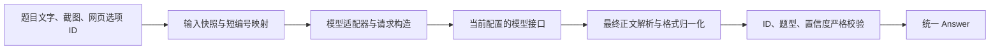

# 模型接入与题目中继

GUI、章节批量任务和单题重试都通过 `modules.llm.VisionLLM` 使用同一个 `LLMRelay`。不需要启动额外服务；已有 URL、Key 和历史答案文件保持兼容。

## 接入范围

当前支持 OpenAI 兼容的 **Chat Completions** 协议。兼容性取决于服务商的实际请求和响应格式，不取决于模型名称。

| 项目 | 当前要求与支持范围 |
|---|---|
| 请求地址 | HTTP(S) 基础地址或完整 `/chat/completions` 地址 |
| 认证 | `Authorization: Bearer <Key>`；暂不支持自定义认证头 |
| 请求方式 | POST JSON，包含 `model` 和 `messages`，支持 `system` / `user` 消息 |
| 图片输入 | `user.content` 中的 `image_url` 部分，图片为 Base64 data URL |
| 返回方式 | 非流式 JSON，外层 `choices` 恰好包含一个候选，最终答案位于 `choices[0].message.content` |
| 可选输出约束 | 提示词 JSON、JSON 模式、JSON Schema；后两者需服务商支持 |
| 未适配 | 原生 Anthropic Messages、Gemini、Responses API、SSE 流式返回、工具调用答案 |

基础请求形状参考 [Chat Completions 官方协议](https://developers.openai.com/api/reference/resources/chat/subresources/completions/methods/create)，图片部分参考 [官方 Base64 图片输入示例](https://developers.openai.com/api/docs/guides/images-vision)。第三方标注“OpenAI 兼容”仍需确认支持多模态请求；仅支持文字聊天不足以处理截图题干。

URL 不会自动探测或转换协议。例如 `https://api.example.com/v1` 会请求 `https://api.example.com/v1/chat/completions`；完整地址则保持不变。仅对已适配的硅基流动官方根地址补 `/v1`，未知服务只填域名不会补版本路径。不要填服务商网页地址或原生 `/responses` 地址。

## DeepSeek 与硅基流动

以下兼容实现依据官方文档核对，核对日期为 **2026-10-10**。服务商的模型目录、能力与账户权限可能变化，配置名称需以实际平台为准。

| 服务 | 推荐基础地址 | 适配器 | 输出约束 |
|---|---|---|---|
| DeepSeek 官方 | `https://api.deepseek.com` | `auto` 或 `deepseek` | `prompt` / `json`；选择 `schema` 时官方接口自动改用 JSON 模式 |
| 硅基流动 | `https://api.siliconflow.cn/v1` | `auto` 或 `siliconflow` | 首次用 `prompt`，确认具体模型支持后可用 `json` / `schema` |
| 其他兼容网关 | 服务商指定的基础地址 | `auto` 或 `generic`；必要时手动指定 | 以网关和模型能力为准 |

### DeepSeek 官方

[官方入门文档](https://api-docs.deepseek.com/)给出的 OpenAI 格式基础地址是 `https://api.deepseek.com`。以下示例使用文档当前的 `deepseek-flash` 名称；其他名称需核对账号可用模型。

```ini
[llm-model-1]
url = https://api.deepseek.com
key = YOUR_DEEPSEEK_KEY
model = deepseek-flash
adapter = auto
responseMode = json
```

适配通过 `image_url` 传入截图，读取 `message.content` 中的最终答案，忽略独立的 `reasoning_content`。官方 Chat Completions 文档当前列出的 `response_format` 为 `text/json_object`，所以官方域名下的 `schema` 会转换为 `json_object`，并继续本地严格校验；第三方网关中的同名模型保留原输出约束。参见 [官方请求与响应定义](https://api-docs.deepseek.com/api/create-chat-completion/)及 [图片输入指南](https://api-docs.deepseek.com/guides/vision/)。

请求明确使用 `stream=False`。不自动设置思考开关或推理强度，遵循服务端默认行为；推理较长时可在 GUI 调整请求超时。`length`、`aborted`、`insufficient_system_resource` 都视为生成未完成，即使正文看似完整也不采用。

### 硅基流动

基础地址采用官方的 `https://api.siliconflow.cn/v1`，也允许输入根地址 `https://api.siliconflow.cn` 自动补齐版本路径。模型名保留平台完整形式，包括组织前缀和可能的 `Pro/` 前缀，不会自动改名。协议参考 [官方 Chat Completions 定义](https://docs.siliconflow.cn/docs/api/chat-completions-post)。

```ini
[llm-model-2]
url = https://api.siliconflow.cn/v1
key = YOUR_SILICONFLOW_KEY
model = YOUR_SILICONFLOW_VISION_MODEL
adapter = auto
responseMode = prompt
```

适配明确请求 `stream=False`、`n=1`，图片保留 Base64 data URL 与 `detail=high`。InternVL 系列按官方建议将图片放在文字前，其余模型沿用文字后接图片的格式。最终答案仍只读取 `message.content`，不将思考字段作为答案。参见 [官方视觉模型指南](https://docs.siliconflow.cn/docs/userguide/capabilities/vision)。

选择能接受图文消息的 VLM；纯文字模型和只返回 OCR 文本的模型不能直接替代答题模型。JSON 与 Schema 是否支持需按模型确认，接口拒绝可选输出约束时仍采用现有参数恢复机制，保留图片与题目信息。参见 [官方 JSON 模式说明](https://docs.siliconflow.cn/docs/userguide/guides/json-mode)。

### 自动识别与手动覆盖

`auto` 先匹配完整官方主机名 `api.deepseek.com` / `api.siliconflow.cn`，再按模型名称识别已有模型系列。不会因域名中包含品牌字样就认定为官方接口。模型系列识别兼容 `Pro/组织/模型` 等前缀，但不推断模型能力。

显式选择的适配器优先于自动识别。硅基流动上的 DeepSeek 模型应使用 `auto` 或 `siliconflow`；第三方网关中模型名与原厂相同，也不能据此假定网关支持原厂所有参数。

## 模型能力与首次配置

用于章节截图的模型需要：

- **读图能力**：实际接受 Base64 图片，能识别题干中的中文、符号和图表。仅会生成图片的模型不适用。
- **指令与结构输出能力**：结合题干和选项，输出完整 JSON，包含可匹配的选择与置信度。
- **最终答案正文**：答案要写入 `message.content`；仅返回思考过程或 `reasoning_content` 不够。
- **足够的输入与输出额度**：允许题目图片和选项输入，并能完成答案 JSON。额度、上下文长度和图片大小限制以服务商为准。

目前处理单选、多选和判断题。只有完整题干文字且未提供截图的输入可以使用纯文字模型；实际网页题干可能只能通过截图读取，因此不能把纯文字接口当作通用配置。置信度是模型自评，不是经校准的正确率，也不代表网站得分。

首次接入可以使用以下公共配置，或在 GUI 填写对应字段。示例中的地址、Key 和模型名称需要替换；模板默认留空。

```ini
[llm-option]
url = https://api.example.com/v1
key = YOUR_API_KEY
model = YOUR_VISION_MODEL
adapter = generic
responseMode = prompt
jsonMode = False
autoSubmit = False
minConfidence = 0.8
```

`prompt` 无需接口支持 `response_format`，程序会自动加入 JSON 提示词并校验返回。确认服务商支持后可选择 `json` 或 `schema`。JSON 模式只约束 JSON 的有效性，结构输出另行约束字段结构；具体模型及 Schema 支持范围仍需核对服务商文档，参见 [官方结构输出说明](https://developers.openai.com/api/docs/guides/structured-outputs?api-mode=chat)。本地选项与置信度校验在所有模式下都会执行。

GUI 的模型名称下拉框允许直接输入新名称。预设模型和 `generic/minimax/qwen/glm/kimi/deepseek/siliconflow` 适配器不是可用性认证，也不意味着同系列所有模型都支持图片。模型槽内 URL / Key 留空继承公共接口，可分别配置不同服务商。

在“章节测试”选中模型后，到“模型设置”点击“测试所选模型接口（自制图片）”进行基础验证。测试会发送自制算术图片，不发送课程题目，可能产生接口费用；通过只代表当次认证、图片请求、简单识别和答案解析正常，不保证复杂题目正确率或长期稳定性。



## 文件职责

| 文件 | 职责 |
|---|---|
| `modules/llm_types.py` | 配置、`Question` / `Answer`、本地记录严格校验 |
| `modules/llm_adapters.py` | 输入快照、短编号映射、模型选择、请求格式、返回归一化 |
| `modules/llm_relay.py` | HTTP 调用、参数兼容、有界重试、诊断和调用轨迹 |
| `modules/llm.py` | 兼容原来的导入路径及 `VisionLLM` 名称 |

## 输入和输出

输入时给每个选项生成 `option_1`、`option_2` 等短编号，模型收到选项文字和实际字母标签；网页 ID 保留在本地映射中。映射按这一题的输入快照建立，返回后转换为真实 ID，再由原有章节逻辑核对网页中的题目和选项。

输入会检查题型、选项唯一性以及截图实际格式，支持 PNG、JPEG、WEBP 和 GIF。只有明确提供完整题干文字而未提供截图时，才按纯文字题发送；不会将无效图片文件作为图片上传。

模型优先返回：

```json
{"choices":["option_2"],"confidence":0.9,"explanation":"说明"}
```

这段是模型的**答案正文**，不是 HTTP 响应的外层结构。用户不需要手动设置输出提示词，程序已要求模型遵循这个约定。

| 正文字段 | 约定 |
|---|---|
| `choices` | 非空短编号数组，编号必须来自本题 `allowed_choices`；单选和判断题恰好一个，多选题可有多个，不能重复 |
| `confidence` | 必须提供，取值为 0–1 的有限数值；建议直接返回数字，如 `0.9` |
| `explanation` | 简短说明字符串；推荐始终提供，普通解析允许省略后记为空字符串，Schema 模式要求提供 |

典型的完整 HTTP 响应如下，其中外层 `choices` 是接口候选列表，正文中的 `choices` 才是题目选项：

```json
{
  "choices": [
    {
      "index": 0,
      "message": {
        "role": "assistant",
        "content": "{\"choices\":[\"option_2\"],\"confidence\":0.9,\"explanation\":\"说明\"}"
      },
      "finish_reason": "stop"
    }
  ]
}
```

中继也接受 `message.content` 直接为答案对象，或由 `text/output_text` 文本块组成的列表；列表中的 `thinking/reasoning` 块不作为最终答案。接口外层若改为 `output`、`data.choices` 或顶层 `answer`，当前不能直接读取。下面的字段别名与包裹兼容只作用于取出的**答案正文**，不代表接受任意 HTTP 响应结构。

允许归一化的形式包括：

- `choices`、`option_ids`、`answer`、`answers`、`answer_ids`、`selected_options` 及中文答案字段。
- 标量、数组、选项对象，以及明确分隔的多选字母。
- 当前题目中唯一的实际字母标签或精确选项文字；旧格式网页 ID 必须完全匹配，不把数字当位置。
- JSON 代码块、带前后说明的唯一 JSON 对象、最多三层的 `answer/result/data` 包裹。
- 正文文本分块、直接 JSON 正文和已结束的 `<think>/<thinking>` 前缀；思考区中的 JSON 不作为答案。
- 数值置信度、数值字符串及明确带 `%` 的百分比。缺失置信度、高/中/低等模糊描述、裸数值 `95` 不会自动补成 `0.95`。

未知选项、重复选择、歧义、字段冲突、单选返回多个选项仍会失败。旧记录只接受已经规范化的真实 ID，不能用模型输出适配放宽本地回填校验。

例如 `{"answer":"B","confidence":"90%"}` 可以在实际 B 标签唯一匹配时归一化；只返回 `B`、`{"choices":[]}` 或缺少置信度则不满足要求。程序不会推测缺失的置信度，也不会把数字 `2` 当作“第二个选项”。建议新接口统一采用短编号正文，别名兼容用于容忍模型偏离。

## 适配与配置

当前实现面向 OpenAI 兼容的 **Chat Completions** 接口。自动按官方域名识别 DeepSeek / 硅基流动，再识别 MiniMax、Qwen、GLM、Kimi / Moonshot、DeepSeek 模型系列；其他名称使用通用适配器。原生 Anthropic Messages、Gemini 和 Responses API 未包含在本实现中。

```ini
[llm-option]
adapter = auto
responseMode = auto

[llm-model-1]
adapter =
responseMode =
```

模型槽内留空时继承公共设置。`adapter` 可选 `auto/generic/minimax/qwen/glm/kimi/deepseek/siliconflow`；网关使用自定义模型别名时可手动指定。GUI 的“模型设置”中也提供这两个字段。

| responseMode | 行为 |
|---|---|
| `auto` | 保留旧设置：`jsonMode=True` 时使用 JSON 模式，否则使用提示词约束 |
| `prompt` | 提示词要求 JSON，返回后本地严格校验 |
| `json` | 请求 `response_format=json_object` |
| `schema` | 请求包含当前题目短编号枚举的 JSON Schema；DeepSeek 官方适配转为 JSON 模式 |

MiniMax M3 系列会请求 `reasoning_split=True`，并兼容思考标签形式。此参数及文本/图像请求格式依据 [MiniMax 官方兼容接口文档](https://platform.minimax.io/docs/api-reference/text-openai-api)。Qwen 的结构输出仍取决于模型与渠道支持，参见 [官方结构输出说明](https://help.aliyun.com/zh/model-studio/qwen-structured-output)。

接口明确拒绝 `response_format`、`reasoning_split` 或图片 `detail` 时，可移除该可选参数重试；截图和题目信息保留。兼容结果只在当前中继实例内缓存，按接口、模型、适配器、输出模式和凭据摘要隔离。不会通过丢弃图片让文字模型伪装成视觉模型。

## 重试与记录

每题最多三次请求，总次数包括网络重试、可选参数恢复、生成中断重试和格式修复。格式修复重新发送同一题及校验错误，不续接模型思考历史；截断或服务端中断会重新请求同一题，不误标成格式修复。402、401、明确拒绝作答及低置信度不会通过格式重试绕过。

统一返回仍是 `Answer(option_ids: list[str], confidence: float, explanation: str)`。业务继续使用现有置信度阈值；中继不会提高模型置信度或补造答案。

成功/失败记录中的 `relay` 保存适配器、实际输出约束、请求次数与恢复步骤。DeepSeek 官方的 Schema 转 JSON 会记录 `schema_to_json`；生成中断记录 `generation` 阶段。反复格式错误的去敏正文保存在 `llm_diagnostics`；GUI 单题重试失败另存 `response-errors/`，保留原答案。诊断不保存请求 Authorization、API Key 或图片 Base64。

## 常见接入问题

| 现象 | 排查方向 |
|---|---|
| 404 或找不到接口 | 检查基础地址、版本路径及最终 `/chat/completions` 地址 |
| 400 / 422 | 查看服务商错误详情，确认图片输入、消息角色和所选输出约束受支持；可选参数恢复不能解决模型不支持图片的问题 |
| 401 / 402 | 检查 Key、权限、余额或渠道计费；不会通过反复请求解决 |
| 429 / 5xx / 网络超时 | 受请求次数预算限制重试，可调整请求间隔；不保证重试成功 |
| 缺少 `choices[0].message.content` | 接口外层协议不兼容、返回多个候选，或没有最终答案正文 |
| 答案格式错误 | 检查正文是否有唯一 JSON、有效选项及置信度；查看去敏诊断，格式修复仍受每题最多三次请求限制 |
| 低置信度 | 答案格式可以是有效的；按阈值跳过或留空，可切换模型重答，无需放宽格式校验 |

## 扩展其他接口

同一协议下新增模型通常只需填写服务商实际模型名称；需要额外参数或不同正文格式时，可继承 `ModelAdapter`，覆盖 `build_request`、`read_response` 或 `parse_response`，并注册到 `ADAPTERS`。返回结果必须经过共同的 `normalize_answer` / `parse_answer` 校验；不要按模型名称硬编码题目答案。

接入原生协议则还需扩展 `LLMSettings.endpoint` 与 `LLMRelay` 的传输、认证及响应处理，不能只增加模型名或答案字段别名。扩展时应保留统一的 `Question → Answer` 约定，并用模拟响应验证正常、拒绝、截断和格式异常场景。

## 验证

`tests/test_llm_relay.py` 检查输入映射、字段格式、字母/文字歧义、百分比、思考隔离、参数恢复、明确拒绝与阈值保护；章节测试检查中继返回后仍按真实 ID 操作本地页面夹具。

`tests/test_llm_providers.py` 使用官方协议形状的模拟响应，覆盖 DeepSeek / 硅基流动的地址、认证、图文顺序、JSON 输出约束、最终答案与思考隔离、错误恢复和中断预算。测试不读取实际配置，不向服务商发送请求；账号连通性仍需用户配置后用 GUI 接口测试验证。
